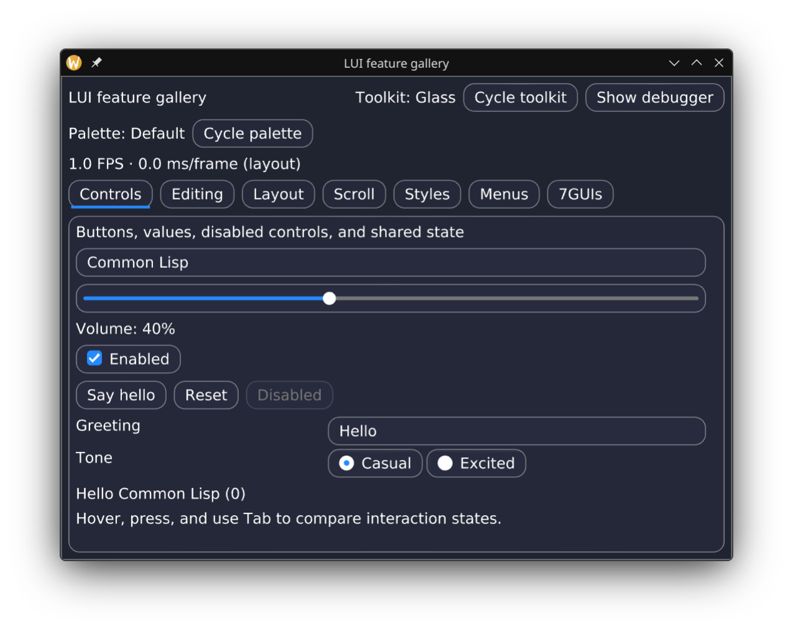
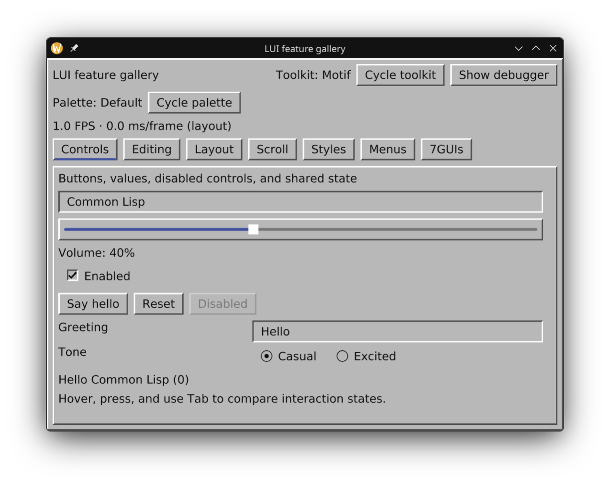
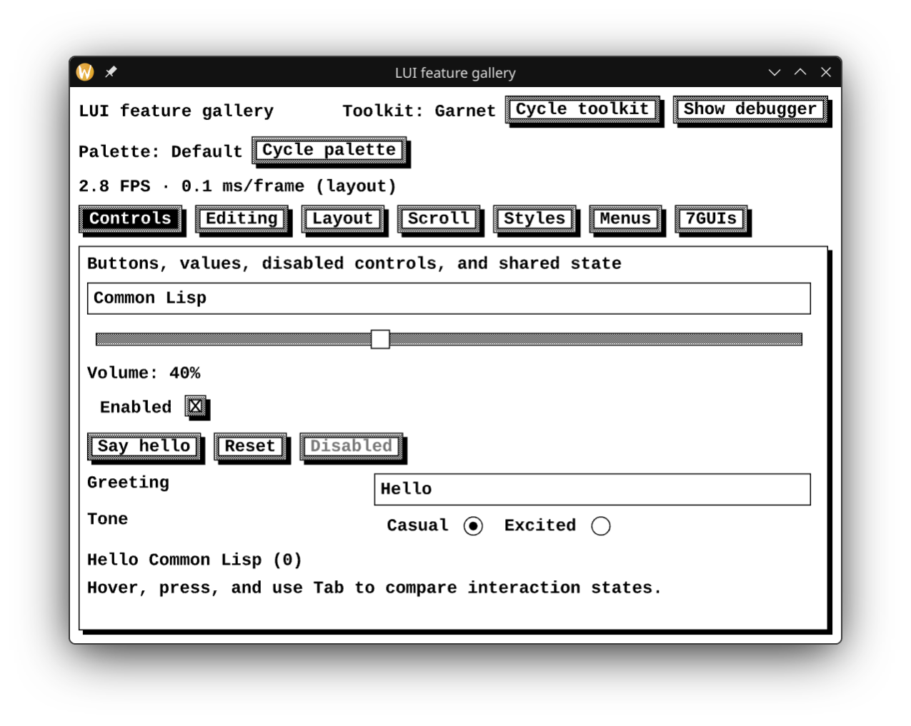
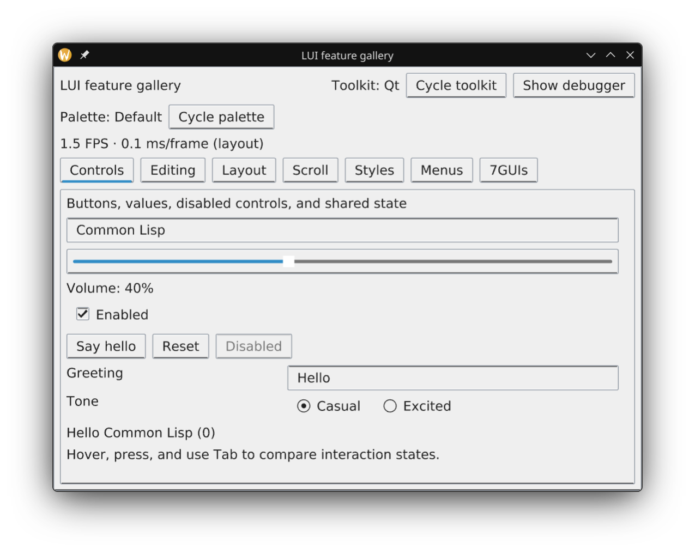
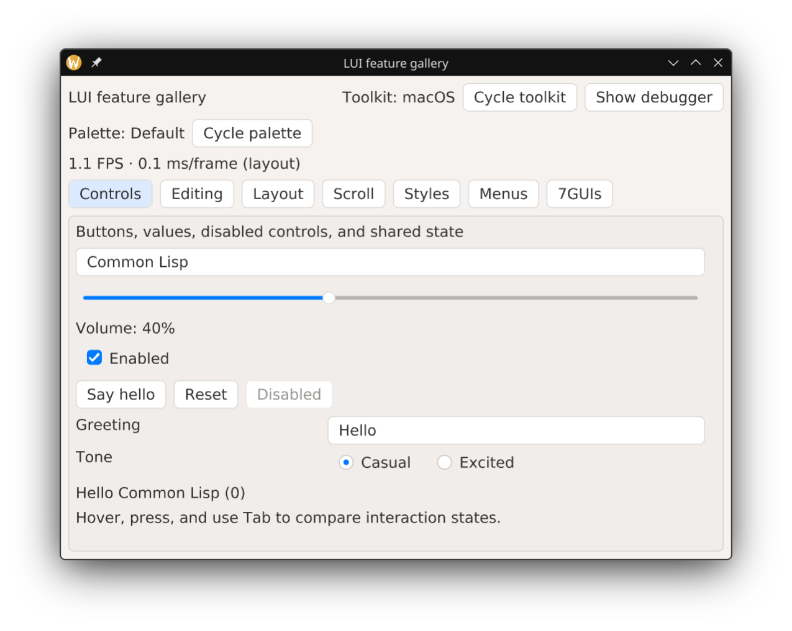
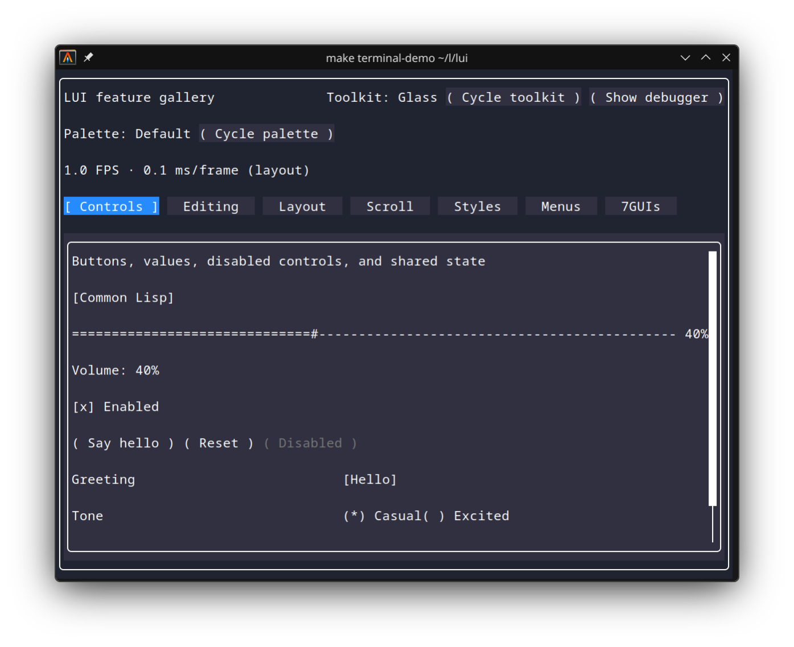

# Demo and Docs
https://visendev.github.io/lui/

# FAQ

- What is this? 
  Lui is an immediate mode common lisp ui library.
  
- Was this developed with AI?
  Yes.
  
- Is the README written by AI?
  No, the readme was entirely human written.
  
- Is this slop?
  Depends on what you mean by that. If you consider anything developed using
  AI to be slop, then yes. However, because I am developing this project
  primary to for me to use (manually coding) at work to build business 
  software, code quality is very important. 
  
  To that end, the codebase has purposefully been kept very small and minimal.
  The core of the ui library is less than 5kloc measured by 
  [CLOC](https://github.com/aldanial/cloc), the rest of the code being about
  another 10kloc for backends, and various widget styling toolkits. I have
  kept the codebase small that way it is easy for me to manually review all 
  of the code.
  
- What dependencies does Lui require?
  The core has no external dependencies, most backends require cffi though. 
  The terminal backend uses [uncursed](https://github.com/plisp/uncursed).
  
- Is this just a wrapper over a C windowing library?
  No, everything interfaces with OS apis directly, allowing you to build
  small self contained lisp executables.
  
- What backends are supported?
  Linux Wayland,
  Linux X11,
  ANSI Terminal (TUI),
  Macos Cocoa,
  Windows Win32
  PDF (for doing document layouts)
  Web via [JSCL](https://github.com/jscl-project/jscl)
  Web via ECL and EMSCRIPTEN
  
- What styles does the UI support?
  Lui has the concept of different widget "toolkits", with different
  toolkits each emulating the look and feel of various famous UI libraries
  or OS native functionality. 
  
  Glass
  

  Motif
  

  Garnet (based on [the library from the 80s](https://www.cs.cmu.edu/afs/cs.cmu.edu/project/garnet/www/)
  

  QT
  

  Macos
  

- What does the TUI version of the UI look like?
  

- Do you need to write different UI code based on the platform?
  No, write your UI code once, and it can be run natively, in your terminal,
  or on the web.
